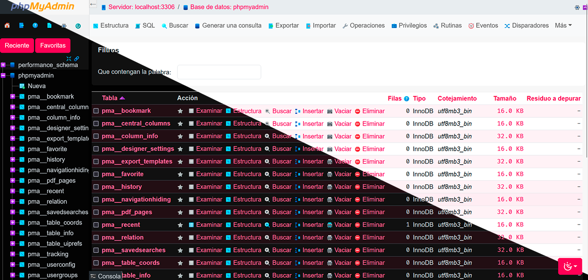

# Pirulug PMA Theme

Un tema moderno y compacto en modos Dark y Light para phpMyAdmin, desarrollado con Bootstrap 5.3 y Sass.

[English version (Ingles)](README.md)



## Caracteristicas

- **Modos Dark y Light:** Soporte nativo para alternancia de modos mediante variables CSS y el atributo `data-bs-theme`.
- **Tipografia Optimizada:** Tamano de fuente reducido (`0.875rem` / 14px base) para una densidad y legibilidad ideal en tablas de bases de datos.
- **Paleta de Color Pirulug:** Acento primario `#ff0055` con contrastes calibrados para interfaces claras y oscuras.
- **Iconografia Dinamica:** Soporte de iconos SVG adaptables automaticamente segun el modo de color activo.
- **Compatibilidad:** Compatible con phpMyAdmin 5.0, 5.1, 5.2 y 6.0.

## Instalacion

1. Clona o copia esta carpeta dentro del directorio de temas de tu instalacion de phpMyAdmin:
   - En phpMyAdmin estandar: `phpMyAdmin/themes/pma-pirulug-theme`
   - En Laragon u otras distribuciones con directorio publico: `etc/apps/phpMyAdmin/themes/pma-pirulug-theme` y `etc/apps/phpMyAdmin/public/themes/pma-pirulug-theme`
2. Abre phpMyAdmin en tu navegador.
3. Ve a **Configuracion** > **Tema** y selecciona **Pirulug**.

## Desarrollo y Compilacion

El tema utiliza Sass para compilar los estilos hacia CSS:

### Requisitos
- Node.js (v16+)
- npm

### Comandos disponibles

```bash
# Instalar dependencias
npm install

# Compilar SCSS a CSS (desarrollo)
npm run build

# Compilar SCSS a CSS comprimido (produccion)
npm run build:compile

# Modo observador (recompila automaticamente al guardar cambios)
npm run watch
```

## Estructura del Proyecto

```text
pma-pirulug-theme/
├── css/                  # CSS compilado
├── img/                  # Iconos e imagenes del tema
│   └── dark/             # Iconos especificos para modo oscuro
├── scss/                 # Codigo fuente SCSS
│   ├── 0-functions/      # Funciones auxiliares
│   ├── 1-variables/      # Variables de color, fuentes y temas
│   ├── 2-mixins/         # Mixins reutilizables
│   ├── 3-components/     # Botones, tarjetas y dropdowns
│   ├── 4-layout/         # Estilos de navegacion, tablas, consola y layout
│   ├── 6-vendor/         # Estilos de librerias externas
│   ├── 7-hacks/          # Sobrescrituras y ajustes especificos
│   └── theme.scss        # Archivo maestro SCSS
├── package.json          # Scripts de compilacion y dependencias
├── theme.json            # Metadatos del tema para phpMyAdmin
├── README.md             # Documentacion en ingles
└── README.es.md          # Documentacion en espanol
```

## Licencia

Este proyecto esta bajo la Licencia MIT. Consulta el archivo [LICENSE](LICENSE) para mas detalles.

**Autor:** Pirulug
