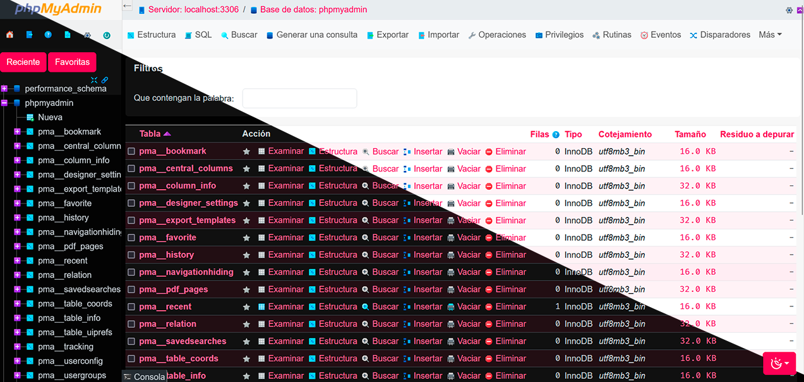

# Pirulug PMA Theme

A modern, compact Dark and Light theme for phpMyAdmin built with Bootstrap 5.3 and Sass.

[Spanish version (Espanol)](README.es.md)



## Features

- **Dark & Light Modes:** Native mode switching using CSS variables and the `data-bs-theme` attribute.
- **Optimized Typography:** Reduced base font size (`0.875rem` / 14px base) for dense, readable database tables and controls.
- **Pirulug Color Palette:** Distinctive `#ff0055` primary accent color with calibrated contrast across light and dark backgrounds.
- **Dynamic Iconography:** Automatic SVG icon adjustments based on the active color theme.
- **Compatibility:** Supports phpMyAdmin 5.0, 5.1, 5.2, and 6.0.

## Installation

1. Clone or copy this repository into your phpMyAdmin themes directory:
   - Standard phpMyAdmin: `phpMyAdmin/themes/pma-pirulug-theme`
   - Laragon or installations with a public directory: `etc/apps/phpMyAdmin/themes/pma-pirulug-theme` and `etc/apps/phpMyAdmin/public/themes/pma-pirulug-theme`
2. Open phpMyAdmin in your web browser.
3. Navigate to **Settings** > **Theme** and select **Pirulug**.

## Development and Build

This theme uses Sass to compile styles into CSS:

### Requirements
- Node.js (v16+)
- npm

### Available Commands

```bash
# Install dependencies
npm install

# Compile SCSS to CSS (development)
npm run build

# Compile SCSS to compressed CSS (production)
npm run build:compile

# Watch mode (automatically recompile on file changes)
npm run watch
```

## Project Structure

```text
pma-pirulug-theme/
├── css/                  # Compiled CSS output
├── img/                  # Theme icons and images
│   └── dark/             # Dark-mode specific icons
├── scss/                 # SCSS source code
│   ├── 0-functions/      # Helper functions
│   ├── 1-variables/      # Color, font, and theme variables
│   ├── 2-mixins/         # Reusable mixins
│   ├── 3-components/     # Buttons, cards, and dropdowns
│   ├── 4-layout/         # Navigation, tables, console, and layouts
│   ├── 6-vendor/         # External vendor styles
│   ├── 7-hacks/          # Targeted overrides and adjustments
│   └── theme.scss        # Master SCSS file
├── package.json          # Build scripts and dependencies
├── theme.json            # phpMyAdmin theme metadata
├── README.md             # English documentation
└── README.es.md          # Spanish documentation
```

## License

This project is open source and available under the [MIT License](LICENSE).

**Author:** Pirulug